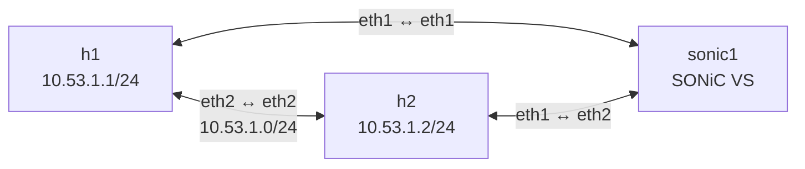

# Лабораторная работа №1 — containerlab и SONiC

## Персональные параметры

| Параметр | Значение |
|---|---|
| Номер ИСУ | 409453 |
| `STUDENT` | `rodionov` |
| `N` | `53` |
| Management-подсеть | `10.101.53.0/24` |
| Подсеть канала h1–h2 | `10.53.1.0/24` |
| Где выполняется работа | Локальная Linux-машина |

## Окружение

Лабораторная работа выполнялась на локальной машине под управлением Ubuntu 22.04 (x86_64).

| Параметр | Результат |
|---|---|
| Containerlab | 0.72.0 |
| Docker Engine | 29.1.2 |
| Логические CPU | 12 |
| Оперативная память | 15 GiB |
| Доступная память на момент проверки | 6,4 GiB |
| Swap | 2 GiB |
| Совпадения `vmx`/`svm` в `/proc/cpuinfo` | 24 |
| Модуль `bridge` | Загружен |
| Модули `vxlan`, `tun` | Не отображались в `lsmod` |

Пользователь входит в группы `docker` и `clab_admins`, поэтому команды Docker и containerlab выполняются без использования `sudo`.

Для лабораторной были подготовлены следующие образы:

- `docker-sonic-vs:202511` — базовый образ SONiC VS;
- `sonic-course:202511` — учебный образ SONiC;
- `lab-tools:1.0` — вспомогательный Linux-образ.

Версия SONiC:

```yaml
branch: '202511'
commit_id: '59efd5867'
sonic_os_version: 13
asic_type: vs
```

### Почему SONiC VS не требует аппаратной виртуализации

SONiC VS запускается в Docker-контейнере и использует ядро Linux хостовой системы. В данном случае не требуется запуск отдельной гостевой операционной системы под гипервизором.

MikroTik CHR в лабораторной работе №5 представляет собой виртуальную машину. При запуске через гипервизор аппаратные расширения Intel VT-x или AMD-V могут использоваться для аппаратного ускорения виртуализации.

## Топология

Лабораторный стенд состоит из трёх узлов:

- `h1` — первый Linux-хост;
- `h2` — второй Linux-хост;
- `sonic1` — виртуальный сетевой коммутатор SONiC VS.



Конфигурация стенда находится в [`lab1.clab.yml`](lab1.clab.yml).

Mermaid-схема containerlab сохранена в `docs/lab1.clab.mermaid`.

## Соответствие портов

| Порт в топологии | Порт SONiC | Lanes | Alias |
|---|---|---|---|
| `h1:eth1` — `sonic1:eth1` | `Ethernet0` | `25,26,27,28` | `fortyGigE0/0` |
| `h2:eth1` — `sonic1:eth2` | `Ethernet4` | `29,30,31,32` | `fortyGigE0/4` |

В виртуальной платформе SONiC один интерфейс может занимать несколько lanes. В исследуемой конфигурации на один порт выделено четыре lanes, поэтому следующие интерфейсы имеют номера `Ethernet0` и `Ethernet4`, а не `Ethernet0` и `Ethernet1`.

Прямое соединение между `h1` и `h2` реализовано через интерфейсы `eth2`. Оно использовалось для проверки связности между хостами.

## Ответы на контрольные вопросы

### Службы SONiC

В стандартной архитектуре SONiC основные службы распределены по нескольким контейнерам:

| Служба | Контейнер | Назначение |
|---|---|---|
| `orchagent` | `swss` | Обработка данных APPL_DB и формирование объектов ASIC_DB |
| `portsyncd` | `swss` | Обработка событий физических портов |
| `syncd` | `syncd` | Взаимодействие с SAI и ASIC |
| `fpmsyncd` | `bgp` | Передача маршрутов из Zebra в APPL_DB |
| `zebra` | `bgp` | Управление таблицами маршрутизации |
| `bgpd` | `bgp` | Реализация протокола BGP |

В учебном образе `sonic-course:202511` проверка выполнялась внутри одного контейнера командой `supervisorctl status`.

По результатам проверки:

- `orchagent` — RUNNING;
- `portsyncd` — RUNNING;
- `syncd` — RUNNING;
- `fpmsyncd` — RUNNING;
- `zebra` — RUNNING;
- `bgpd` — STOPPED.

Таким образом, основные службы управления портами, обработки состояния и взаимодействия с виртуальным ASIC работали.

Причина остановки `bgpd` по одному выводу `supervisorctl status` не устанавливается. Для точного определения причины необходим анализ конфигурации BGP и журналов службы.

### Redis DB

В SONiC Redis используется как механизм обмена данными между компонентами системы.

| База | Номер | Назначение |
|---|---:|---|
| CONFIG_DB | 4 | Хранение конфигурационных параметров |
| APPL_DB | 0 | Данные прикладного уровня, передаваемые между компонентами |
| ASIC_DB | 1 | Объекты и атрибуты для программирования ASIC через SAI |
| STATE_DB | 6 | Хранение операционного состояния системы |

Основной механизм взаимодействия:

1. Менеджеры конфигурации обрабатывают данные CONFIG_DB.
2. Состояние и запросы прикладного уровня передаются через APPL_DB.
3. `orchagent` обрабатывает данные APPL_DB и формирует соответствующие объекты в ASIC_DB.
4. `syncd` получает данные из ASIC_DB и взаимодействует с ASIC через SAI.
5. Службы SONiC обновляют STATE_DB сведениями об операционном состоянии.

После первоначального запуска `Ethernet0` имел состояние `admin_status down`.

После выполнения команды:

```bash
sudo config interface startup Ethernet0
```

в CONFIG_DB появилось значение `admin_status up`, а APPL_DB отразила:

- `admin_status: up`;
- `oper_status: up`.

Это подтвердило изменение административного и операционного состояния интерфейса.

### Пересоздание лаборатории

Для проверки жизненного цикла были выполнены команды:

```bash
containerlab destroy -t lab1.clab.yml --cleanup
containerlab deploy -t lab1.clab.yml
```

После повторного развёртывания все три контейнера успешно запустились.

Проверка Redis показала:

- в CONFIG_DB поле `admin_status` отсутствовало;
- в APPL_DB значение `admin_status` было `down`;
- значение `oper_status` также было `down`.

Команда `show interfaces status` подтвердила состояние `Ethernet0`: Admin down, Oper down.

Следовательно, ручное включение интерфейса не сохранилось после уничтожения и повторного создания контейнера.

Для воспроизводимости стенда необходимо хранить конфигурацию SONiC и сценарии её применения вместе с YAML-топологией. Тогда нужное состояние интерфейсов можно автоматически восстанавливать после каждого запуска.

## Результаты выполнения

В ходе лабораторной работы:

1. Подготовлено окружение containerlab и Docker.
2. Собраны образы `sonic-course:202511` и `lab-tools:1.0`.
3. Создана топология из двух Linux-хостов и SONiC VS.
4. Проверено соответствие портов топологии интерфейсам SONiC.
5. Исследованы службы SONiC и базы данных Redis.
6. Проверено изменение состояния `Ethernet0` через CONFIG_DB и APPL_DB.
7. Выполнена проверка прямой связности между `h1` и `h2`.
8. Проверен жизненный цикл лаборатории `destroy → deploy`.
9. Построена Mermaid-схема топологии.

### Проверка связности

Для проверки прямого соединения использовалась команда:

```bash
docker exec clab-rodionov-l1-h1 ping -c 3 10.53.1.2
```

Соединение между хостами `h1` и `h2` было успешно установлено, потери пакетов отсутствовали.

### Список материалов

- `lab1.clab.yml` — конфигурация топологии.
- `docs/lab1.clab.mermaid` — схема топологии в формате Mermaid.
- `README.md` — описание лабораторной работы, конфигурации и результатов.

### Репозиторий

Ссылка на удалённый репозиторий: добавить после публикации.
