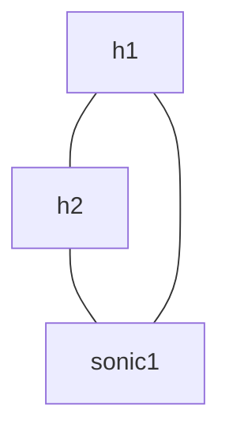

# Лабораторная работа №1 — containerlab и SONiC

## Персональные параметры

| Параметр | Значение |
| --- | --- |
| Номер ИСУ | 409453 |
| `STUDENT` | `rodionov` |
| `N` | `53` |
| Management-подсеть | `10.101.53.0/24` |
| Подсеть канала h1–h2 | `10.53.1.0/24` |
| Где выполняется работа | Локальная Linux-машина |

## Окружение

Предварительная проверка показала: x86_64, Ubuntu 22.04, 12 CPU и 15 GiB RAM; установлен containerlab 0.72.0. Docker Server отвечает версией 29.1.2 при проверке с доступом к Docker. В обычной сессии текущий пользователь не может открыть `/var/run/docker.sock`, поэтому команды развёртывания из неё пока не выполняются. Образы `sonic-course:202511` и `lab-tools:1.0` не найдены, исходного каталога `images/` в рабочем пространстве тоже нет.

В выводе `lsmod` загружен `bridge`; `vxlan` и `tun` не показаны. Число от `egrep -c '(vmx|svm)' /proc/cpuinfo` — 24 совпавшие строки. Перед сдачей повторить проверки в рабочей сессии и сохранить полный вывод.

### Почему SONiC VS не требует аппаратной виртуализации

SONiC VS запускается как Linux-контейнер и использует ядро хоста. В учебном варианте пересылку пакетов выполняет программный dataplane на Linux; гостевая ОС под гипервизором не запускается. MikroTik CHR в ЛР5 запускается как виртуальная машина, поэтому ему нужна поддержка аппаратной виртуализации процессором и гипервизором.

## Топология

Конфигурация стенда находится в [`lab1.clab.yml`](lab1.clab.yml). Имена и адреса используют `STUDENT=rodionov` и `N=53`.

## Соответствие портов

| Порт в топологии | Порт SONiC | Lanes | Alias |
| --- | --- | --- | --- |
| `sonic1:eth1` (с h1) | `Ethernet0` | заполнить по `show interfaces status` | заполнить по `show interfaces alias` |
| `sonic1:eth2` (с h2) | `Ethernet4` | заполнить по `show interfaces status` | заполнить по `show interfaces alias` |

В виртуальной платформе SONiC Ethernet-порты обычно нумеруются с шагом по числу lanes, выделенных одному порту. Поэтому после `Ethernet0` следует `Ethernet4`; номера обозначают базовые lane-индексы, а не порядковые номера интерфейсов.

## Ответы на вопросы

### Службы SONiC

В обычной архитектуре `orchagent` и `portsyncd` относятся к контейнеру `swss`; `syncd` работает в контейнере `syncd`; `fpmsyncd`, `zebra` и `bgpd` относятся к маршрутизационным службам FRR в контейнере `bgp`. В учебном образе несколько служб могут быть собраны в одном контейнере, поэтому `supervisorctl status` показывает процессы образа, а не раскладку по отдельным контейнерам.

Причину состояния `STOPPED` у `bgpd` нужно подтвердить по фактическому выводу этого образа (например, состоянию feature BGP и журналу supervisor). Сам по себе факт отсутствия BGP-соседей не доказывает, что демон должен быть остановлен. Заполнить после запуска `sonic-course:202511`.

### Redis DB

| База | Номер | Роль |
| --- | ---: | --- |
| CONFIG_DB | 4 | Желаемая конфигурация SONiC |
| APPL_DB | 0 | Состояние/запросы прикладного уровня, потребляемые оркестратором |
| ASIC_DB | 1 | Объекты и атрибуты SAI для программирования ASIC или виртуального dataplane |
| STATE_DB | 6 | Операционное состояние, сообщаемое службами |

Нет одной универсальной службы, которая копирует все базы целиком. Менеджеры `swss` читают относящиеся к ним записи из CONFIG_DB и публикуют рабочее состояние в APPL_DB; `orchagent` обрабатывает APPL_DB и программирует объекты в ASIC_DB. Службы также обновляют STATE_DB наблюдаемым состоянием. Для отчёта приложить фактические выводы до и после `config interface startup Ethernet0`.

### Пересоздание лаборатории

Изменение `admin_status` в CONFIG_DB относится к текущей конфигурации работающего SONiC. При уничтожении и создании контейнера эта конфигурация не обязана сохраняться; без сохранённой стартовой конфигурации интерфейс вернётся к состоянию из образа. Для воспроизводимости нужно хранить конфигурацию SONiC вместе с топологией и загружать её при старте (либо выполнять идемпотентные команды конфигурации как часть процедуры запуска). Проверить поведение после `destroy`/`deploy` и записать фактический результат.

## Результаты выполнения

Этот раздел заполнить по факту запуска. Для сдачи нужны выводы `containerlab inspect`, `show interfaces status`, `show interfaces alias`, Redis-команд до/после включения порта и успешный ping `h1` → `h2`, а также скриншот финального вывода задания 5.2.

- `sonic_version.yml`: добавить содержимое после запуска SONiC.
- `bgpd`: зафиксировать фактический статус и подтверждённую причину.
- `admin_status` после пересоздания: заполнить.
- Ссылка на удалённый репозиторий: добавить после публикации.
